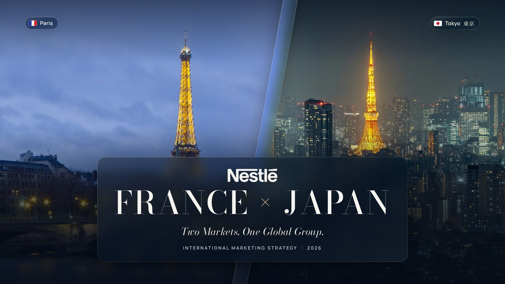

# Nestlé: France × Japan, interactive presentation

A six-scene, full-screen presentation comparing how Nestlé adapts **KitKat**, **Nescafé** and **Maggi** to France and Japan.
It is a redesign of `source/NESTLE-FRANCE-JAPAN_original.pptx`, which is kept unchanged as a read-only backup.



## Present it

You can open `index.html` directly in Chrome, Edge, Safari or Firefox: everything is local, with no build step and no internet needed.
For the smoothest playback, serve the folder instead:

```
python3 -m http.server 8000      # then open http://localhost:8000
```

Press **F** for full screen. The deck is authored on a 1920×1080 canvas and scales to any screen without clipping or reflowing.

| Key / gesture | Action |
|---|---|
| → · Space · Page Down | Next slide |
| ← · Page Up | Previous slide |
| 1–6 · Home · End | Jump to a slide |
| F | Toggle full screen |
| Esc | Close an open brand focus or the credits panel; otherwise leave full screen |
| Swipe left / right | Next / previous (touch) |
| Slide 2: hover, click or tap a brand | Emphasise it, then open its France / Japan comparison |

The control bar (bottom right) appears when you move the pointer. It has slide progress, the count, previous/next, a **Reduce motion** toggle,
image credits and full screen. Reduce motion follows the OS setting by default; the toggle is remembered per browser.
A slide can be linked directly: `index.html#4`.

## What's inside

```
index.html                 the six scenes (semantic HTML; text stays real text)
styles/fonts.css           self-hosted Bodoni Moda, Manrope, Noto Serif JP (subset to the words used)
styles/global.css          tokens, scaled 1920×1080 stage, transition FX layer, presenter controls
styles/glass.css           the glass system: chip, caption, divider, deep/clear variants, animated edge light
styles/slides.css          per-scene compositions
styles/animations.css      CSS-only ambient motion (steam) and reduced-motion overrides
scripts/animations.js      motion tokens and reusable GSAP building blocks (word masks, glass materialise, product entrances)
scripts/transitions.js     the five scene-to-scene transitions and the glass-sheet fallback
scripts/navigation.js      the navigation state machine (one transition at a time, queued input, idle loops)
scripts/interactions.js    slide 2 brand focus, keyboard, touch swipe, full screen, reduced motion, credits
scripts/main.js            boot: stage scaling, image preloading, headline fitting
scripts/credits.js         generated image credits (tools/build_register.py)
slides/slide-0N.js         one timeline module per scene; split-kit.js is shared by the three comparison scenes
assets/                    optimised WebP photographs, cut-outs, logos, fonts
docs/                      screenshots, walkthrough.mp4, ASSET_REGISTER.md, QUALITY_REPORT.md
NESTLE-FRANCE-JAPAN_redesign_static.pptx   static PowerPoint backup (one full-bleed composition per slide, with speaker notes)
source/                    the original PowerPoint, unmodified
tools/                     scripts that rebuild the register, the credits and the PowerPoint backup
```

Each slide module exposes `reset()`, `enter()` (returns a GSAP timeline), `idle()` and `stop()`.
The navigator resets the incoming scene, runs the transition, starts the entrance at the swap point, and starts idle loops only once the scene has settled.
Inactive scenes run nothing.

## Rebuilding generated files

```
python3 tools/build_register.py   # docs/ASSET_REGISTER.md + scripts/credits.js
python3 tools/build_pptx.py       # static PowerPoint from docs/screenshots (needs python-pptx)
```

## Credits and licences

- Photographs: Wikimedia Commons, under the licences listed in `docs/ASSET_REGISTER.md` and in the in-deck credits panel.
  Cut-outs are adaptations, and CC BY-SA adaptations are shared under the same licence.
- Logos are trademarks of Société des Produits Nestlé S.A., used here for academic analysis.
- Fonts: Bodoni Moda, Manrope and Noto Serif JP, under the SIL Open Font License (`assets/fonts/OFL-*.txt`).
- Animation: [GSAP](https://gsap.com) 3.12.5 (`scripts/vendor/gsap.min.js`), under GreenSock's standard no-charge licence.
