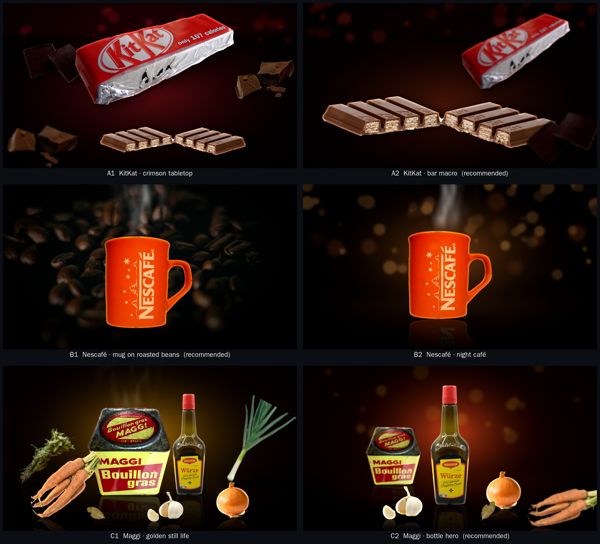

# Asset test batch 01: KitKat, Nescafé, Maggi

These are review candidates only. **Nothing in the presentation uses them yet**: `index.html`, `assets/` and the animation system are unchanged.
They will replace existing assets only after you approve them.

## How they were made

No generative AI was used in this batch.

- **Generators blocked.** fal.ai was skipped at your request, Gamma has no credits, and IMG.LY needs a sign-in.
- **Packaging is the authentic photographs** (Wikimedia Commons; see `docs/ASSET_REGISTER.md`).
  - Cut-outs were made with rembg and upscaled 4× with Real-ESRGAN x4plus (run locally on CPU via ncnn).
  - Each was then only scaled, rotated, colour-matched and given rim light. No pixel of packaging was generated.
- **Sets are built the way studio packshots are shot.** They use lit seamless sweeps or a high-angle tabletop surface, plus contact and cast shadows, gloss-floor reflections, bokeh and a steam layer.
  - All are rendered at 3840×2160 by `tools/studio.py` in the build scratchpad.
- **Props are real photographs:**
  - chocolate chunks (SKopp, CC BY-SA 3.0);
  - dark chocolate (Mx. Granger, CC0);
  - roasted coffee beans (A S M Jobaer, CC BY-SA 4.0);
  - pot-au-feu ingredients already in the register.

## Files per candidate (descriptive names; 16:9; ready for parallax)

| File | Use |
|---|---|
| `*_composite_3840x2160.jpg` | Full frame |
| `*_preview_1920x1080.jpg` | Review |
| `*_layer-background_3840x2160.jpg` | Set only (backdrop, floor, light). Slowest parallax layer. |
| `*_layer-products_3840x2160.webp` | Packshots and props, with their shadows and reflections, on transparency |
| `*_layer-atmosphere_3840x2160.webp` | Steam and bokeh, on transparency. Screen-blend it, or replace it with the deck's CSS steam. |

## Quality control

**Fidelity** is the structural similarity (SSIM) of each authentic packshot as placed against its source photo, with rotation taken into account.
1.00 would mean identical. The remaining difference is the added lighting, not changed packaging.

**Sharpness** is the variance of the Laplacian over the product. Higher is sharper; compare it within one product only.

| Candidate | Fidelity | Sharpness | Verdict |
|---|---|---|---|
| **A1** KitKat · crimson tabletop | wrapper 0.975 · bar 0.952 | wrapper 154 · bar 1127 | **Conditional.** The staging works, but the hero wrapper is a 2008 snapshot: soft, with flat flash light and dark foil creases. Upscaling cleaned it but cannot add detail. |
| **A2** KitKat · bar macro | bar 0.905 | 538 | **Recommended.** The crisp classic bar is the hero, and the wrapper sits defocused behind it, which hides its weaknesses. |
| **B1** Nescafé · mug on beans | 0.983 | 219 | **Recommended.** The real Nescafé logo is printed on the cup, set on real roasted beans in amber light. The steam is subtle. |
| **B2** Nescafé · night café | 0.980 | 233 | Acceptable, but the bokeh-only set feels more generic than B1. |
| ~~B2 v0~~ café-au-lait cup | — | — | **Rejected.** The source photo crops the cup and its logo, and the cut-out lost the saucer. |
| **C1** Maggi · golden still life | tin 0.950 · bottle 0.975 | 734 · 1237 | Acceptable. Busy, and the ingredient photos were lit differently from each other. |
| **C2** Maggi · bottle hero | bottle 0.979 | 1091 | **Recommended.** The label is crisp and fully legible (including the Nutri-Score), with a red-to-gold brand light and a defocused heritage tin. |

## Limits and open points

- **Ceiling of the sources.** These look like good studio composites, not like an international FMCG campaign shoot.
  The KitKat wrapper and the Nescafé mug are amateur photos with their own lighting, so no grading fully hides that.
  Reaching campaign level needs **sharp, evenly lit, authentic packshots**. Any of these would do:
  - official press-kit or retailer images you're entitled to use (the brand sites are blocked from this environment);
  - your own photos of the real products: a phone, a window, a white card and a black card are enough.
- **Coffee surface.** None of the authentic branded-cup photos shows the coffee surface: the mug was shot at eye level, and the café-au-lait cup was rejected.
  A top-angle photo of a real Nescafé cup would fix this.
- **Market labels.** The KitKat pack is UK (2008) and the Maggi bottle is German ("Würze"). They suit brand-level slides, but not slots labelled as France or Japan.
- **Noodles.** Not used: Maggi noodles aren't part of the France/Japan story here. Pot-au-feu stock ingredients match the deck's Maggi Bouillon content.
- **AI environments.** If you later enable a generator, it would replace only `layer-background`. The packshot and prop layers and the QC check stay the same.
